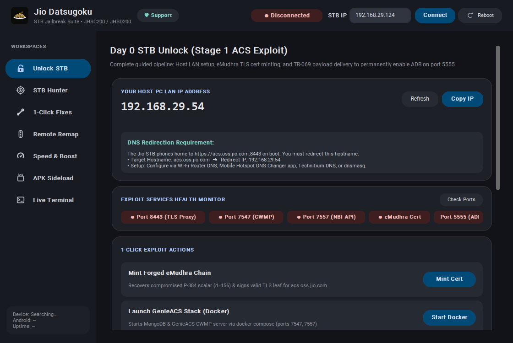
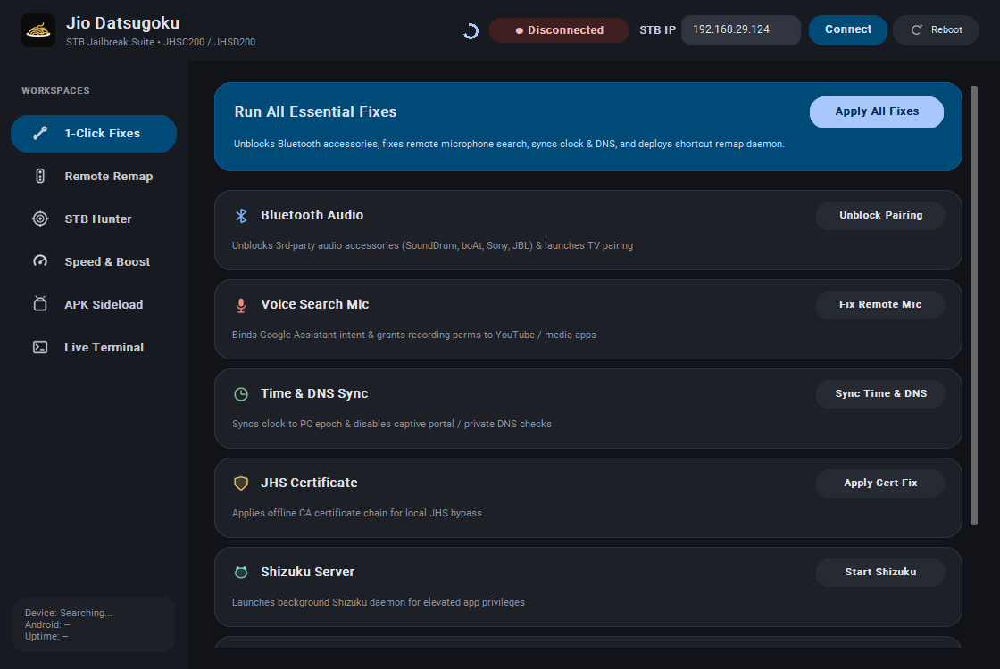
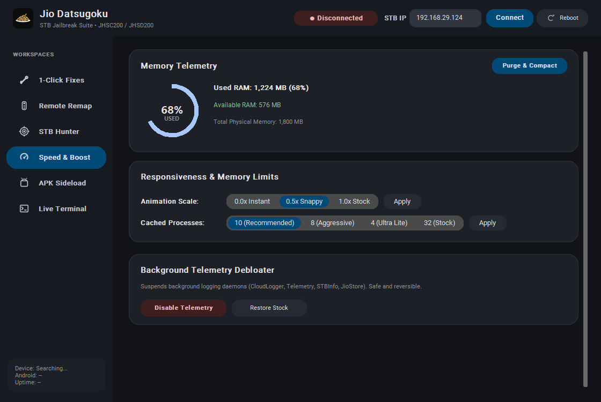
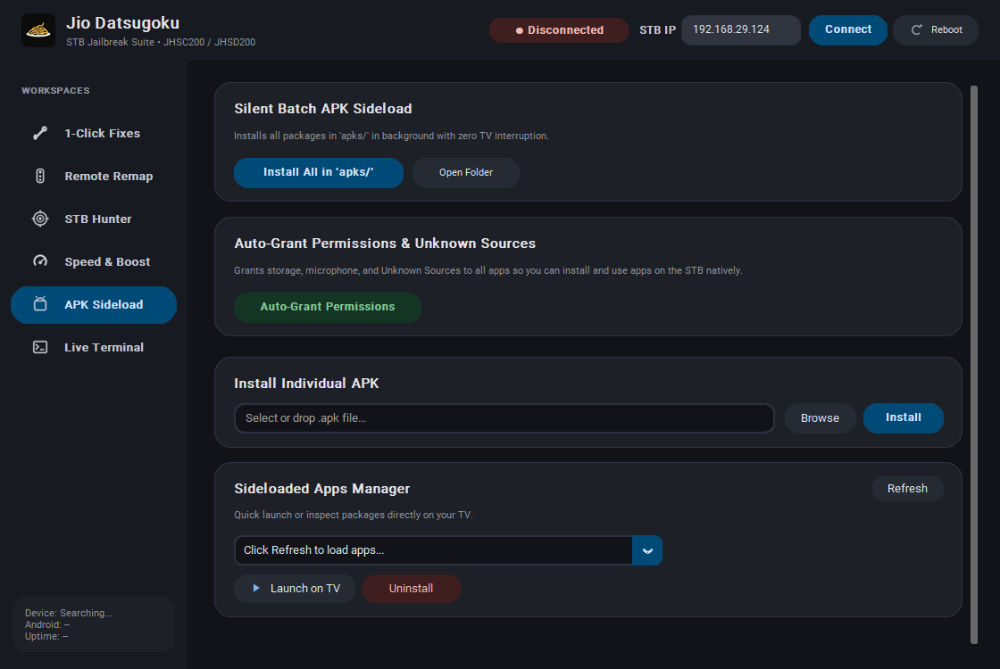
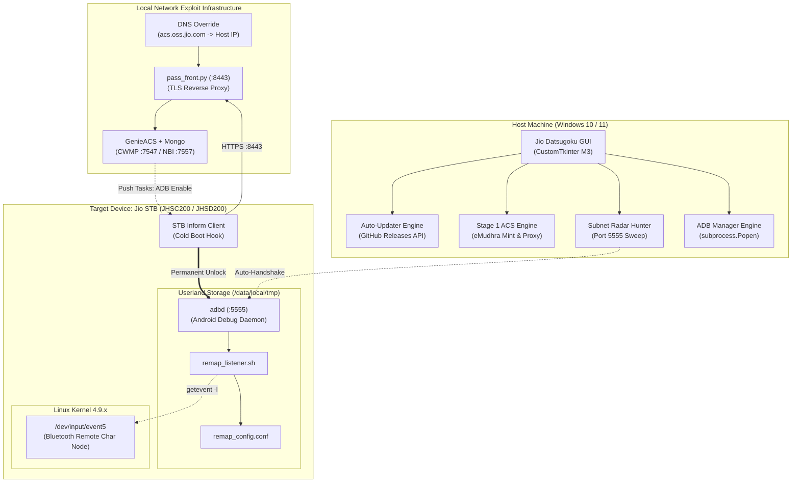

<div align="center">

  

  # Datsugoku GUI

  <p align="center">
    <b>All-in-One Desktop Station: Day 0 ACS Jailbreak, Autonomous Radar, Kernel Remapping & System Management for Jio STB (JHSC200 / JHSD200)</b>
  </p>

  <p align="center">
    <a href="https://github.com/RookieEnough/Datsugoku-GUI"></a>
    &nbsp;
    <a href="https://github.com/RookieEnough/Datsugoku-GUI"></a>
    &nbsp;
    <a href="https://www.python.org/"></a>
    &nbsp;
    <a href="https://m3.material.io/"></a>
    &nbsp;
    <a href="LICENSE"></a>
  </p>

  <p align="center">
    <a href="https://github.com/RookieEnough/Datsugoku-GUI/releases/latest"><b>Download Standalone Exe</b></a> •
    <a href="#architectural-overview">Architecture</a> •
    <a href="#key-engineering-features">Key Features</a> •
    <a href="#installation--setup">Installation</a> •
    <a href="#community--donations">Support & Community</a> •
    <a href="#educational--legal-disclaimer">Disclaimer</a>
  </p>

  <p align="center">
    An all-in-one open-source desktop control station and exploit automation suite designed for the <b>Jio Set-Top Box (JHSC200 / JHSD200)</b> running Android TV 9.0 (Pie). Datsugoku GUI manages the entire device lifecycle: from Day 0 out-of-the-box ACS/TR-069 exploitation (eMudhra TLS cert minting, DNS spoof guidance, and GenieACS task queueing) to post-unlock autonomous radar connection, physical remote button remapping, essential system repairs, and batch APK sideloading.
  </p>

</div>

---

## Visual Overview

| Day 0 Jailbreak & ACS Unlock | Physical Remote Remapper |
| :---: | :---: |
|  |  |

| 1-Click Essential System Fixes | Autonomous Subnet Hunter |
| :---: | :---: |
|  |  |

| Performance & Memory Telemetry | Batch APK Sideloading Pipeline |
| :---: | :---: |
|  |  |

---

## Table of Contents

- [Architectural Overview](#architectural-overview)
- [Key Engineering Features](#key-engineering-features)
  - [1. Day 0 STB Unlock (Stage 1 ACS Exploit Pipeline)](#1-day-0-stb-unlock-stage-1-acs-exploit-pipeline)
  - [2. In-App Background Auto-Updater](#2-in-app-background-auto-updater)
  - [3. Kernel Input Event Remapping](#3-kernel-input-event-remapping)
  - [4. Autonomous Subnet Hunter](#4-autonomous-subnet-hunter)
  - [5. One-Click Essential System Repairs](#5-one-click-essential-system-repairs)
  - [6. Real-Time Memory Telemetry & LMK Optimization](#6-real-time-memory-telemetry--lmk-optimization)
  - [7. Batch APK Sideloading Pipeline](#7-batch-apk-sideloading-pipeline)
  - [8. Material 3 Desktop Architecture](#8-material-3-desktop-architecture)
- [System Architecture](#system-architecture)
- [Device Compatibility Matrix](#device-compatibility-matrix)
- [Installation & Setup](#installation--setup)
  - [Option A: Standalone Executable (Windows x64)](#option-a-standalone-executable-windows-x64)
  - [Option B: Running from Source](#option-b-running-from-source)
  - [Option C: Compiling with PyInstaller](#option-c-compiling-with-pyinstaller)
- [Configuration Reference (`remap_config.conf`)](#configuration-reference-remap_configconf)
- [Community & Donations](#community--donations)
- [Troubleshooting & Diagnostics](#troubleshooting--diagnostics)
- [Educational & Legal Disclaimer](#educational--legal-disclaimer)
- [Credits & Acknowledgments](#credits--acknowledgments)

---

## Architectural Overview

Jio Set-Top Box units (such as the SDMC DV8219 / JHSC200 / JHSD200) ship from the factory in a restricted, vendor-locked state:
1. **Disabled ADB:** USB and network debugging are permanently disabled out of the box.
2. **Remote Button Hijacking:** Dedicated streaming buttons (Netflix, YouTube, Hotstar, Voot/JioCinema) transmit proprietary Linux input event codes bound to stock OEM applications.
3. **Hidden Settings & Disabled Voice:** Standard AOSP Bluetooth accessory discovery screens are blocked, and generic voice remotes fail to bind to voice search intents.
4. **Firmware Lockdown (FOTA):** Silent over-the-air firmware upgrades overwrite user changes.

**Datsugoku GUI** bridges the entire journey in a single desktop application:
* **Stage 1 (Initial Break-in):** Leverages the TR-069/CWMP phone-home protocol (`acs.oss.jio.com:8443`), forges intermediate CA chains, runs local TLS reverse proxying, and instructs GenieACS to permanently flip `Device.JioSTB.USB.USBDebugging=true`.
* **Stage 2 (Post-Unlock Management):** Immediately catches the unlocked STB via autonomous subnet radar, manages kernel remote key hooks, applies system fixes, and batch sideloads third-party software.

---

## Key Engineering Features

### 1. Day 0 STB Unlock (Stage 1 ACS Exploit Pipeline)
* **Automatic Host LAN Detection:** Automatically resolves and displays your host PC's primary LAN IP (e.g. `192.168.29.54`) with a 1-click **Copy IP** button for instant router DNS configuration.
* **DNS Redirection Guidance:** Step-by-step visual guidance to redirect `acs.oss.jio.com` ➔ `[Your Host PC IP]` on your Wi-Fi router, mobile hotspot, or local DNS server (dnsmasq / Technitium).
* **Live Service Health Monitor:** Real-time port and service diagnostic indicators checking:
  * `Port 8443 (TLS Proxy)`
  * `Port 7547 (GenieACS CWMP)`
  * `Port 7557 (GenieACS NBI API)`
  * `eMudhra Cert Chain` status (`tls/forged_chain.pem`)
  * `Port 5555 (STB ADB Status)`
* **1-Click eMudhra Cert Minting:** Built-in automation of `jhs/forge_emudhra_chain.py` recovering the compromised P-384 scalar ($d=156$) and generating valid TLS certificates that bypass STB trust store verification.
* **1-Click Docker & TLS Proxy Controls:** Launch GenieACS via Docker Compose and toggle `pass_front.py` directly from the GUI.
* **1-Click TR-069 Payload Queueing:** Pushes `Device.JioSTB.USB.USBDebugging=true`, `Device.JioSTB.USB.DebugValidityDate=2037`, and FOTA disable commands directly to GenieACS.

### 2. In-App Background Auto-Updater
* **Boot Release Check:** On application startup, asynchronously checks the GitHub API for new releases (`RookieEnough/Datsugoku-GUI`).
* **Slide-Down Notification Banner:** When an update is detected, a Material 3 action bar slides down with the new version tag, release notes link, and an **"Update Now"** button.
* **1-Click Self-Update Engine:** Downloads the latest executable, deploys an atomic swap script (`updater_swap.bat`), terminates the current process, replaces the binary, and relaunches automatically.

### 3. Kernel Input Event Remapping
* **Zero-Root Character Device Hook:** Deploys `remap_listener.sh` to `/data/local/tmp/`, monitoring `/dev/input/event5` via `getevent -l`.
* **Debouncing & State Filtering:** Filters specifically for keydown transitions (`value 1`) and discards keyup bounces (`value 0`).
* **Intent Dispatcher:** Dispatches applications using internal AOSP `monkey -p <target_package> -c android.intent.category.LAUNCHER 1` execution paths.

| Key Identifier | Event Keycode | Default Hardware Target | Default Custom Target |
| :--- | :---: | :--- | :--- |
| `HOTSTAR_PKG` | `KEY_PROG1` (184) | Hotstar (Stock OEM) | `in.startv.hotstar` |
| `NETFLIX_PKG` | `KEY_PROG2` (185) | Netflix (Stock OEM) | `app.netmirror.newtv` |
| `VOOT_PKG` | `KEY_PROG3` (186) | Voot / JioCinema | `com.viacom18.tv.voot` |
| `YOUTUBE_PKG` | `KEY_PROG4` (187) | Jio YouTube | `io.gh.reisxd.tizentube.cobalt` |

### 4. Autonomous Subnet Hunter
* **Asynchronous Socket Probe:** Uses non-blocking socket connections across local `/24` subnets querying port 5555.
* **Instant Handshake:** Automatically catches the STB upon boot/reconnect, establishing the ADB connection without manual IP entry.
* **Animated M3 Radar:** Visual radar sweep with real-time attempt counters and elapsed execution timers.

### 5. One-Click Essential System Repairs
* **Unblock Bluetooth Pairing:** Invokes `com.android.tv.settings.accessories.AddAccessoryActivity` to pair third-party gamepads, headphones, and remotes.
* **Voice Search Activation:** Configures microphone permissions and binds generic Bluetooth remotes to AOSP voice search intents.
* **System Clock Sync:** Synchronizes the device hardware clock against reliable NTP pool servers over ADB shell.
* **Daemon Persistence:** Verifies background remap execution loops and running PID states.

### 6. Real-Time Memory Telemetry & LMK Optimization
* **Live `/proc/meminfo` Parsing:** Directly queries memory metrics (`MemTotal`, `MemAvailable`, `MemFree`, `Cached`).
* **Curved Arc Gauge:** Visualizes RAM saturation via a vector arc meter.
* **Process Trimming:** Trims active background processes using `am kill-all` and clears temporary caches.

### 7. Batch APK Sideloading Pipeline
* **Multi-Package Queue:** Sequential silent installation using `pm install -r -d -g`.
* **Automated Runtime Permissions:** Automatically grants `RECORD_AUDIO`, `READ/WRITE_EXTERNAL_STORAGE`, and unknown sources.

### 8. Material 3 Desktop Architecture
* **Design System:** Built on Google Material Design 3 Expressive guidelines.
* **Tonal Surfaces:** Dark obsidian palette (`#10131A`, `#1D2027`, `#272B33`) with electric cyan primary accents (`#A8C7FA`) and gold tertiary accents (`#FFDDAE`).
* **Thread-Safe Architecture:** Worker threads decouple ADB I/O from the GUI event loop using asynchronous thread-safe message queues.

---

## System Architecture



---

## Device Compatibility Matrix

| Hardware Platform | SoC / Motherboard | Android Version | Kernel Version | Support Tier |
| :--- | :--- | :---: | :---: | :---: |
| **Jio STB JHSC200** | Amlogic S905X2 / SDMC DV8219 | 9.0 (Pie) | 4.9.113 | Tier 1 (Fully Tested) |
| **Jio STB JHSD200** | Amlogic S905X2 / Skyworth | 9.0 (Pie) | 4.9.113 | Tier 1 (Fully Tested) |
| **Generic Android TV** | Amlogic / Rockchip / Allwinner | 9.0 – 12.0 | 4.x / 5.x | Tier 2 (Generic ADB features) |

---

## Installation & Setup

### Option A: Standalone Executable (Windows x64)
1. Download the latest `JioDatsugoku.exe` from the [Releases](https://github.com/RookieEnough/Datsugoku-GUI/releases) page.
2. Ensure `adb.exe` is in the same folder or in `PATH`.
3. Launch `JioDatsugoku.exe` (or run `Launch-Jio-Datsugoku.bat`).

### Option B: Running from Source
```bash
# 1. Clone the repository
git clone https://github.com/RookieEnough/Datsugoku-GUI.git
cd Datsugoku-GUI

# 2. Create and activate a virtual environment
python -m venv venv
venv\Scripts\activate

# 3. Install required dependencies
pip install -r requirements.txt

# 4. Launch the application
python jio_toolbox_gui.py
```

### Option C: Compiling with PyInstaller
```bash
pyinstaller --noconfirm --clean --windowed --onefile \
    --name "JioDatsugoku" \
    --icon "app_icon.ico" \
    --add-data "assets;assets" \
    jio_toolbox_gui.py
```

---

## Configuration Reference (`remap_config.conf`)

```ini
# ===================================================================
# Jio STB Remote Hardware Key Mapping Configuration
# Location: /data/local/tmp/remap_config.conf
# ===================================================================

# Button: Hotstar (KEY_PROG1 / Keycode 184)
HOTSTAR_PKG=in.startv.hotstar

# Button: Netflix (KEY_PROG2 / Keycode 185)
NETFLIX_PKG=app.netmirror.newtv

# Button: Voot / JioCinema (KEY_PROG3 / Keycode 186)
VOOT_PKG=com.viacom18.tv.voot

# Button: YouTube (KEY_PROG4 / Keycode 187)
YOUTUBE_PKG=io.gh.reisxd.tizentube.cobalt
```

---

## Community & Donations

If you find **Datsugoku GUI** helpful, consider supporting open-source hardware independence and software preservation:

<div align="center">

  <a href="https://buymeachai.ezee.li/RookieZ" target="_blank">
    
  </a>
  &nbsp;&nbsp;
  <a href="https://ko-fi.com/rookie_z" target="_blank">
    
  </a>
  &nbsp;&nbsp;
  <a href="https://paypal.me/RookieEnough" target="_blank">
    
  </a>

  <br /><br />

  <a href="https://discord.com/invite/CrM6y4ujnq"></a>
  &nbsp;
  <a href="https://x.com/_Rookie_Z"></a>
  &nbsp;
  <a href="https://github.com/RookieEnough"></a>
  &nbsp;
  <a href="https://orionstore.pages.dev"></a>

</div>

---

## Troubleshooting & Diagnostics

### 1. "Device Unauthorized" in ADB
* **Symptom:** Connection badge shows "Unauthorized" or returns exit code 1.
* **Resolution:** Check your TV screen for the **"Allow USB debugging?"** prompt. Select **"Always allow from this computer"** and click **OK**.

### 2. Daemon Inactive After Device Reboot
* **Symptom:** Remote buttons open default OEM apps again after a cold reboot.
* **Explanation:** Android clears `/data/local/tmp` background processes during cold restarts.
* **Resolution:** Open Datsugoku GUI, open the **Remote Remap** tab, and click **Deploy Remap Daemon**.

### 3. Port 5555 Connection Refused
* **Symptom:** Network scan finds IP, but handshake times out.
* **Resolution:** Network ADB debugging must be enabled on the target device:
  ```bash
  adb tcpip 5555
  ```

---

## Educational & Legal Disclaimer

> [!IMPORTANT]
> **PLEASE READ CAREFULLY BEFORE USING THIS SOFTWARE:**
> 
> 1. **Educational & Research Purpose Only:** This software and accompanying documentation are developed and distributed strictly for educational, security auditing, and hardware interoperability research under applicable fair use provisions.
> 2. **No Liability / Use at Your Own Risk:** The author (`RookieEnough`) and contributors accept **no responsibility or liability** for any damage, data loss, bricked hardware, bootloops, voided manufacturer warranties, or violations of third-party Terms of Service resulting from the use or misuse of this tool.
> 3. **Non-Affiliation Notice:** This project is an independent open-source research initiative. It is not affiliated with, authorized by, endorsed by, or sponsored by **Reliance Jio Infocomm Ltd.**, **Google LLC**, **Netflix Inc.**, **The Walt Disney Company (Disney+ Hotstar)**, or any of their subsidiaries. All trademarks, registered logos, and brand names belong to their respective owners.

---

## Credits & Acknowledgments

* **Lead Architect & Reverse Engineering:** [Sarthak Sinha (RookieEnough)](https://github.com/RookieEnough)
* **CustomTkinter UI Framework:** [Tom Schimansky](https://github.com/TomSchimansky/CustomTkinter)
* **Exploit Research & ACS PoC:** Bihaan Sen, ak_0o7, Otus9051, Vishal Beniwal.
* **Underlying Platform Tools:** Android Open Source Project (AOSP) & Android Debug Bridge (ADB).

---

## License

This project is licensed under the **MIT License** — see the [LICENSE](LICENSE) file for complete details.
