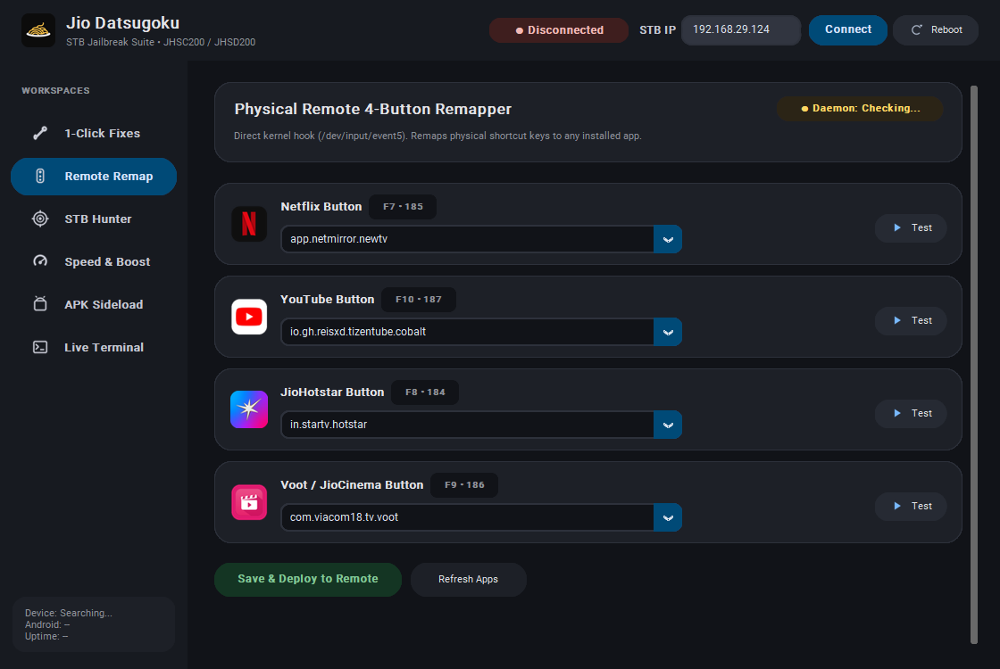
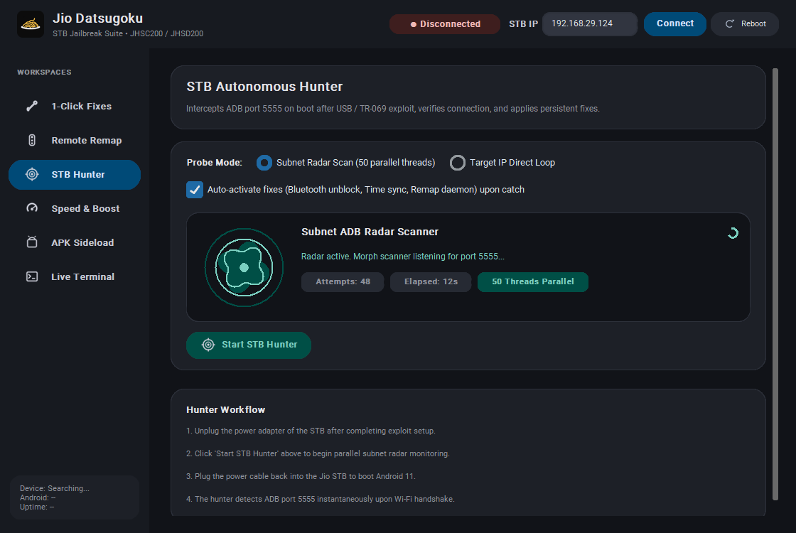
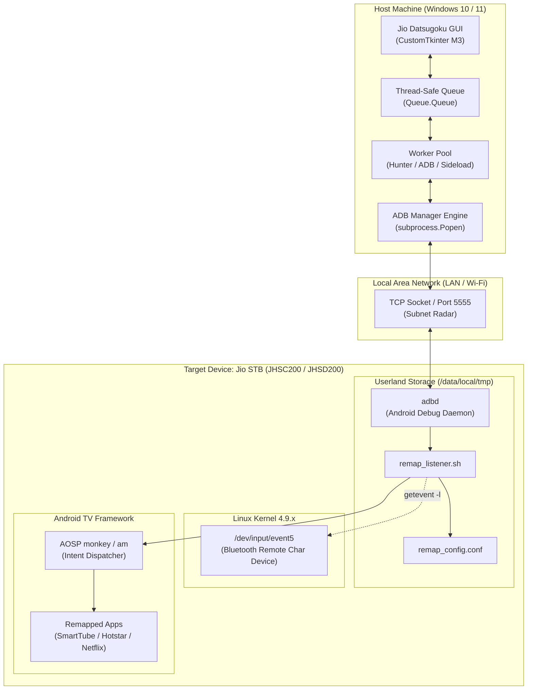

<div align="center">

  

  # Datsugoku GUI

  <p align="center">
    <b>Professional Desktop Control Suite & Kernel Input Remapper for Jio Android TV (JHSC200 / JHSD200)</b>
  </p>

  <p align="center">
    <a href="https://github.com/RookieEnough/Datsugoku-GUI"></a>
    &nbsp;
    <a href="https://github.com/RookieEnough/Datsugoku-GUI"></a>
    &nbsp;
    <a href="https://www.python.org/"></a>
    &nbsp;
    <a href="https://m3.material.io/"></a>
    &nbsp;
    <a href="LICENSE"></a>
  </p>

  <p align="center">
    <a href="https://github.com/RookieEnough/Datsugoku-GUI/releases/latest"><b>Download Executable (v1.0.0)</b></a> •
    <a href="#architectural-overview">Architecture</a> •
    <a href="#key-engineering-features">Key Features</a> •
    <a href="#installation--setup">Installation</a> •
    <a href="#troubleshooting--diagnostics">Troubleshooting</a>
  </p>

  <p align="center">
    An open-source desktop control station, diagnostic suite, and kernel input remapper designed for the <b>Jio Set-Top Box (JHSC200 / JHSD200)</b> running Android TV 9.0 (Pie). Datsugoku GUI provides a centralized, non-root management interface to unlock restricted hardware features, redirect hardcoded remote control buttons, resolve OEM firmware limitations, monitor real-time system performance, and batch sideload third-party applications over local ADB networks.
  </p>

</div>

---

## Visual Overview

| Physical Remote Remapper | 1-Click Essential System Fixes |
| :---: | :---: |
|  |  |

| Autonomous Subnet Hunter | Performance & Memory Telemetry |
| :---: | :---: |
|  |  |

---

## Table of Contents

- [Architectural Overview](#architectural-overview)
- [Key Engineering Features](#key-engineering-features)
  - [1. Kernel Input Event Remapping](#1-kernel-input-event-remapping)
  - [2. Autonomous Subnet Hunter](#2-autonomous-subnet-hunter)
  - [3. One-Click Essential System Repairs](#3-one-click-essential-system-repairs)
  - [4. Real-Time Memory Telemetry & LMK Optimization](#4-real-time-memory-telemetry--lmk-optimization)
  - [5. Batch APK Sideloading Pipeline](#5-batch-apk-sideloading-pipeline)
  - [6. Material 3 Desktop Architecture](#6-material-3-desktop-architecture)
- [System Architecture](#system-architecture)
- [Device Compatibility Matrix](#device-compatibility-matrix)
- [Installation & Setup](#installation--setup)
  - [Option A: Standalone Executable (Windows x64)](#option-a-standalone-executable-windows-x64)
  - [Option B: Running from Source](#option-b-running-from-source)
  - [Option C: Compiling with PyInstaller](#option-c-compiling-with-pyinstaller)
- [Configuration Reference (`remap_config.conf`)](#configuration-reference-remap_configconf)
- [Troubleshooting & Diagnostics](#troubleshooting--diagnostics)
- [Educational & Legal Disclaimer](#educational--legal-disclaimer)
- [Credits & Acknowledgments](#credits--acknowledgments)

---

## Architectural Overview

Jio Set-Top Box units (such as the SDMC DV8219 / JHSC200 / JHSD200) ship with heavily locked-down firmware environments:
1. **Remote Button Hijacking:** Dedicated streaming buttons (Netflix, YouTube, Hotstar, Voot/JioCinema) transmit proprietary Linux input event codes bound to stock, locked applications.
2. **Hidden System Settings:** Standard AOSP Bluetooth accessory discovery and pairing screens are hidden or blocked in favor of restricted OEM companion flows.
3. **Audio & Voice Service Lockout:** Generic Bluetooth remotes with integrated microphones fail to bind to voice search intents due to missing framework permissions.
4. **Network Transport Delays:** Static DHCP assignments or frequent reboots disconnect external ADB management connections.

**Datsugoku GUI** operates without modifying the system partition or tripping bootloader security. It functions entirely through userland ADB debugging protocols (`port 5555`) and persistent `/data/local/tmp` shell daemons.

---

## Key Engineering Features

### 1. Kernel Input Event Remapping
* **Zero-Root Operation:** Rather than replacing system framework binaries or decompiling APKs, the tool deploys `remap_listener.sh` directly to `/data/local/tmp/`.
* **Low-Level Event Monitoring:** Reads raw input events from the remote controller character device node (`/dev/input/event5`) utilizing `getevent -l`.
* **State Filtering & Debouncing:** Filters specifically for keycode down transitions (`value 1`) and discards duplicate release events (`value 0`) to prevent rapid-fire intent re-triggering.
* **Intent Dispatch:** Launches configured applications via Android's internal `monkey -p <target_package> -c android.intent.category.LAUNCHER 1` execution path, bypassing default OEM package interceptors.

| Key Identifier | Event Keycode | Default Hardware Target | Default Custom Target |
| :--- | :---: | :--- | :--- |
| `HOTSTAR_PKG` | `KEY_PROG1` (184) | Hotstar (Stock OEM) | `in.startv.hotstar` |
| `NETFLIX_PKG` | `KEY_PROG2` (185) | Netflix (Stock OEM) | `app.netmirror.newtv` |
| `VOOT_PKG` | `KEY_PROG3` (186) | Voot / JioCinema | `com.viacom18.tv.voot` |
| `YOUTUBE_PKG` | `KEY_PROG4` (187) | Jio YouTube | `io.gh.reisxd.tizentube.cobalt` |

### 2. Autonomous Subnet Hunter
* **Asynchronous Socket Probe:** Uses non-blocking socket connections across local `/24` subnets (e.g., `192.168.1.0/24`, `192.168.29.0/24`) querying port 5555.
* **Autonomous Handshake:** Immediately detects when the STB establishes network connectivity or boots up from a cold restart, initiating an automated `adb connect <ip>:5555` handshake.
* **Visual Radar Telemetry:** Features a dynamic Material 3 animated radar sweep with real-time attempt counters and elapsed execution timers.

### 3. One-Click Essential System Repairs
Automates the sequential execution of essential system repairs:
* **Unblock Bluetooth Pairing:** Direct invocation of `com.android.tv.settings.accessories.AddAccessoryActivity`, allowing the pairing of standard Bluetooth remotes, gamepads, keyboards, and headphones without OEM restrictions.
* **Voice Search Activation:** Configures microphone permissions and maps generic Bluetooth voice remotes to standard AOSP voice input intents.
* **System Clock Sync:** Synchronizes the device hardware clock against reliable NTP pool servers over ADB shell, resolving SSL/TLS certificate failures caused by clock skew.
* **Daemon Persistence:** Installs and verifies the background remap execution loop, verifying running PID state.

### 4. Real-Time Memory Telemetry & LMK Optimization
* **Live `/proc/meminfo` Parsing:** Queries memory utilization (`MemTotal`, `MemAvailable`, `MemFree`, `Cached`) directly from the Linux kernel.
* **Curved Arc Gauge:** Visualizes real-time RAM saturation via a custom vector arc meter.
* **Process Trimming:** Trims active background processes using `am kill-all` and clears temporary caches without requiring root privileges.

### 5. Batch APK Sideloading Pipeline
* **Multi-Package Queue:** Allows multi-file selection of Android application packages (`.apk`).
* **Automated Installation Flags:** Installs packages sequentially using `pm install -r -d -g` (replacing existing builds and auto-granting all declared runtime permissions).
* **Automated Permission Grants:** Automatically grants sensitive permissions post-install, including `android.permission.RECORD_AUDIO`, `android.permission.READ_EXTERNAL_STORAGE`, and `android.permission.WRITE_EXTERNAL_STORAGE`.

### 6. Material 3 Desktop Architecture
* **Design System:** Engineered from the ground up on the Google Material Design 3 (Material You) Expressive specification.
* **Tonal Hierarchy:** Features dark obsidian tonal container surfaces (`#10131A`, `#1D2027`, `#272B33`) with electric cyan primary accents (`#A8C7FA`) and gold tertiary indicators (`#FFDDAE`).
* **Smooth Motion & Spinners:** Custom animated `M3SwirlLoader` canvas components and `M3MorphLoader` continuous polygon interpolators.
* **Thread-Safe Architecture:** Worker threads decouple ADB I/O from the GUI event loop using asynchronous thread-safe message queues.

---

## System Architecture



---

## Device Compatibility Matrix

| Hardware Platform | SoC / Motherboard | Android Version | Kernel Version | Support Tier |
| :--- | :--- | :---: | :---: | :---: |
| **Jio STB JHSC200** | Amlogic S905X2 / SDMC DV8219 | 9.0 (Pie) | 4.9.113 | Tier 1 (Fully Tested) |
| **Jio STB JHSD200** | Amlogic S905X2 / Skyworth | 9.0 (Pie) | 4.9.113 | Tier 1 (Fully Tested) |
| **Generic Android TV** | Amlogic / Rockchip / Allwinner | 9.0 – 12.0 | 4.x / 5.x | Tier 2 (Generic ADB features) |

> [!NOTE]
> Physical remote key remapping requires an input device mapping matching `/dev/input/event5` or standard Linux input subsystem event nodes.

---

## Installation & Setup

### Option A: Standalone Executable (Windows x64)
The simplest way to use Datsugoku GUI without installing Python or dependencies:
1. Download the latest `JioDatsugoku.exe` from the [Releases](https://github.com/RookieEnough/Datsugoku-GUI/releases) page.
2. Ensure `adb.exe` is located in the same directory (or installed system-wide in `PATH`).
3. Launch `JioDatsugoku.exe` (or run `Launch-Jio-Datsugoku.bat`).

### Option B: Running from Source
To run or develop directly from source code:

```bash
# 1. Clone the repository
git clone https://github.com/RookieEnough/Datsugoku-GUI.git
cd Datsugoku-GUI

# 2. Create and activate a virtual environment
python -m venv venv
venv\Scripts\activate

# 3. Install required dependencies
pip install -r requirements.txt

# 4. Launch the application
python jio_toolbox_gui.py
```

### Option C: Compiling with PyInstaller
To generate your own standalone `.exe` with embedded assets and icon bitmaps:

```bash
pyinstaller --noconfirm --clean --windowed --onefile \
    --name "JioDatsugoku" \
    --icon "app_icon.ico" \
    --add-data "assets;assets" \
    jio_toolbox_gui.py
```

The compiled binary will be placed in the `dist/` directory.

---

## Configuration Reference (`remap_config.conf`)

The remote remapper daemon dynamically reads its key bindings from `/data/local/tmp/remap_config.conf` on the target STB:

```ini
# ===================================================================
# Jio STB Remote Hardware Key Mapping Configuration
# Location: /data/local/tmp/remap_config.conf
# ===================================================================

# Button: Hotstar (KEY_PROG1 / Keycode 184)
HOTSTAR_PKG=in.startv.hotstar

# Button: Netflix (KEY_PROG2 / Keycode 185)
NETFLIX_PKG=app.netmirror.newtv

# Button: Voot / JioCinema (KEY_PROG3 / Keycode 186)
VOOT_PKG=com.viacom18.tv.voot

# Button: YouTube (KEY_PROG4 / Keycode 187)
YOUTUBE_PKG=io.gh.reisxd.tizentube.cobalt
```

To update mappings manually over ADB shell:
```bash
adb shell "echo 'YOUTUBE_PKG=com.google.android.youtube.tv' > /data/local/tmp/remap_config.conf"
```

---

## Troubleshooting & Diagnostics

### 1. "Device Unauthorized" in ADB
* **Symptom:** Connection badge displays "Unauthorized" or log reports error code 1.
* **Resolution:** Look at your television screen. A prompt titled **"Allow USB debugging?"** will appear. Check **"Always allow from this computer"** and select **OK** with your remote.

### 2. Daemon Inactive After Device Reboot
* **Symptom:** Remote buttons open default OEM apps again after a reboot.
* **Explanation:** Android clears `/data/local/tmp` background processes during cold restarts.
* **Resolution:** Connect Datsugoku GUI, navigate to the **Remap** tab, and click **Deploy Remap Daemon**.

### 3. Port 5555 Connection Refused
* **Symptom:** Network scan finds IP, but handshake times out.
* **Resolution:** Network ADB debugging must be enabled on the target device:
  ```bash
  adb tcpip 5555
  ```

---

## Educational & Legal Disclaimer

> [!IMPORTANT]
> **PLEASE READ CAREFULLY BEFORE USING THIS SOFTWARE:**
> 
> 1. **Educational & Research Purpose Only:** This software and accompanying documentation are developed and distributed strictly for educational, security auditing, and hardware interoperability research under applicable fair use provisions.
> 2. **No Liability / Use at Your Own Risk:** The author (`RookieEnough`) and contributors accept **no responsibility or liability** for any damage, data loss, bricked hardware, bootloops, voided manufacturer warranties, or violations of third-party Terms of Service resulting from the use or misuse of this tool.
> 3. **Non-Affiliation Notice:** This project is an independent open-source research initiative. It is not affiliated with, authorized by, endorsed by, or sponsored by **Reliance Jio Infocomm Ltd.**, **Google LLC**, **Netflix Inc.**, **The Walt Disney Company (Disney+ Hotstar)**, or any of their subsidiaries. All trademarks, registered logos, and brand names belong to their respective owners.

---

## Credits & Acknowledgments

* **Lead Architect & Reverse Engineering:** [Sarthak Sinha (RookieEnough)](https://github.com/RookieEnough)
* **CustomTkinter UI Framework:** [Tom Schimansky](https://github.com/TomSchimansky/CustomTkinter)
* **Underlying Platform Tools:** Android Open Source Project (AOSP) & Android Debug Bridge (ADB).
* **Community Researchers:** Hardware enthusiasts and contributors across the Android TV reverse-engineering community who documented JHSC200 / JHSD200 hardware nodes and packet structures.

---

## License

This project is licensed under the **MIT License** — see the [LICENSE](LICENSE) file for complete details.
